# rddlrepository


[](https://pypi.org/project/rddlrepository/)
[](https://pyrddlgym.readthedocs.io/en/latest/rddlrepo.html)


**A library of planning and reinforcement learning problems written in RDDL, ready to run in [pyRDDLGym](https://github.com/pyRDDLGym-project/pyRDDLGym).**

[Installation](#installation) | [Quick start](#quick-start) | [Finding problems](#finding-problems) | [Adding your own](#adding-your-own-problems) | [Domain gallery](#domain-gallery)

## Why rddlrepository?

- **Scalable.** Every domain is written in RDDL, so an instance can grow from a handful of objects to a million with just a few lines of RDDL code.
- **Diverse.** Domains come from many disciplines and showcase the latest official RDDL syntax, which makes them good starting points for learning the language.
- **Visual.** Many domains come with custom visualizers for pyRDDLGym.
- **Plug and play.** Everything works out of the box with the [pyRDDLGym ecosystem](https://github.com/pyRDDLGym-project/pyRDDLGym).

## Installation

Install the latest release with pip:

```shell
pip install rddlrepository
```

Or get the pre-release version from GitHub:

```shell
git clone https://github.com/pyRDDLGym-project/rddlrepository.git
```

The visualizers need [pyRDDLGym](https://github.com/pyRDDLGym-project/pyRDDLGym) (``pip install pyRDDLGym``).

### Rebuilding the manifest

If you add domains or instances by hand, rebuild the manifest (rddlrepository >= 2.2):

```shell
rddlrepo rebuild
```

> [!NOTE]
> If you install a new version of rddlrepository on top of an old one, rebuild the manifest as above.
> In versions older than 2.2, delete the ``manifest.csv`` file in the ``core`` folder of your rddlrepository installation instead; it is rebuilt automatically.

## Quick start

With pyRDDLGym installed, create an environment with ``make()``, as in Gym:

```python
import pyRDDLGym
env = pyRDDLGym.make("EarthObservation_ippc2018", "1")
```

``env`` is a Gym ``Env`` with ``reset()`` and ``step()`` ready to use.

## Finding problems

### Listing domains

Everything starts from the ``RDDLRepoManager``:

```python
from rddlrepository.core.manager import RDDLRepoManager
manager = RDDLRepoManager(rebuild=True)
```

List all domains:

```python
print(manager.list_problems())
```

Domains are grouped into contexts, such as a competition year or ``standalone``:

```python
print(manager.list_contexts())
print(manager.list_problems_by_context("standalone"))   # all standalone problems
print(manager.list_problems_by_context("ippc2018"))     # all problems from IPPC 2018
```

### Working with instances

Each domain is described by a ``ProblemInfo``:

```python
problem_info = manager.get_problem("EarthObservation_ippc2018")
```

List its instances:

```python
print(problem_info.list_instances())
```

Get the paths of the domain and of an instance (here ``1``):

```python
print(problem_info.get_domain())
print(problem_info.get_instance("1"))
```

Get its pyRDDLGym visualizer class:

```python
viz_class = problem_info.get_visualizer()
```

Together, these give you full control over how an environment is built:

```python
import pyRDDLGym
env = pyRDDLGym.make(domain=problem_info.get_domain(), instance=problem_info.get_instance("1"))
env.set_visualizer(problem_info.get_visualizer())
```

## Adding your own problems

Register a new context:

```python
manager.register_context("MyContext")
```

Register a new domain in a context:

```python
domain_content = """
    domain ... {
    ...
    }
"""
manager.register_domain("MyDomain", "MyContext", domain_content,
                        desc="a description of this domain", viz="ModuleName.ClassName") 
```

Here ```"ModuleName.ClassName"``` names the module and class of the domain's visualizer (optional).

Register a new instance of an existing domain:

```python
instance_content = """
    instance ... {
    ...
    }
"""
problem_info.register_instance("MyInstance", instance_content)
```

Once registered, they can be loaded later like any other problem.

## Domain gallery

Every problem in the repository, grouped by context, with the identifier to pass to ``make()`` and its instances. Hover over a picture for a description of the domain.

<!-- DOMAINS:START -->

**127 problems in 10 contexts:** [standalone](#standalone) (14) &middot; [physics](#physics) (14) &middot; [or](#or) (7) &middot; [arcade](#arcade) (13) &middot; [gym](#gym) (6) &middot; [rddlsim](#rddlsim) (6) &middot; [ippc2011](#ippc2011) (16) &middot; [ippc2014](#ippc2014) (16) &middot; [ippc2018](#ippc2018) (27) &middot; [ippc2023](#ippc2023) (8)

### standalone

Domains written for this repository.

<table>
<tr><td align="center" valign="top">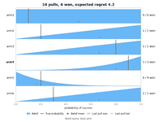<br><code>BernoulliBandit</code><br><sub>instances 0</sub></td><td align="center" valign="top">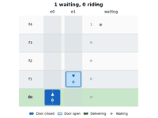<br><code>Elevators</code><br><sub>instances 0, 1</sub></td><td align="center" valign="top">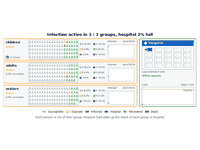<br><code>Epidemic</code><br><sub>instances 0</sub></td><td align="center" valign="top">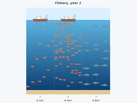<br><code>Fishery</code><br><sub>instances 0</sub></td></tr>
<tr><td align="center" valign="top">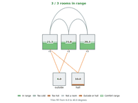<br><code>HVAC</code><br><sub>instances 0, 1</sub></td><td align="center" valign="top">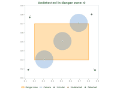<br><code>Intruders_Continuous</code><br><sub>instances 0</sub></td><td align="center" valign="top">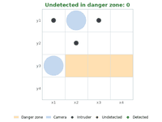<br><code>Intruders_Discrete</code><br><sub>instances 0</sub></td><td align="center" valign="top">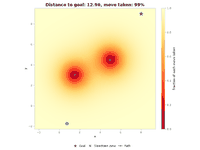<br><code>Navigation_Continuous</code><br><sub>instances 0</sub></td></tr>
<tr><td align="center" valign="top">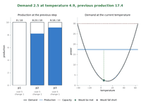<br><code>PowerGen_Continuous</code><br><sub>instances 0</sub></td><td align="center" valign="top">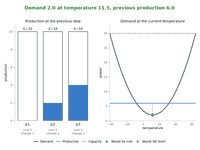<br><code>PowerGen_Discrete</code><br><sub>instances 0</sub></td><td align="center" valign="top">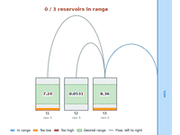<br><code>Reservoir_Continuous</code><br><sub>instances 0, 1</sub></td><td align="center" valign="top">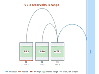<br><code>Reservoir_Discrete</code><br><sub>instances 0, 1</sub></td></tr>
<tr><td align="center" valign="top">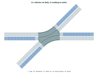<br><code>TrafficBLX_</code><br><code>ComplexPhases</code><br><sub>instances 0</sub></td><td align="center" valign="top">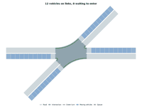<br><code>TrafficBLX_</code><br><code>SimplePhases</code><br><sub>instances 0</sub></td><td></td><td></td></tr>
</table>

<sub>[back to contexts](#domain-gallery)</sub>

### physics

Physical systems and control.

<table>
<tr><td align="center" valign="top">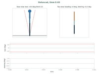<br><code>Bicycle_physics</code><br><sub>instances 0</sub></td><td align="center" valign="top">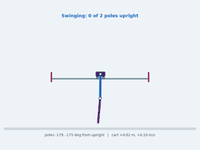<br><code>CartPoleChain_physics</code><br><sub>instances 0, 1</sub></td><td align="center" valign="top">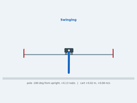<br><code>CartPoleSwingUp_</code><br><code>physics</code><br><sub>instances 0</sub></td><td align="center" valign="top">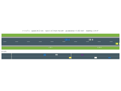<br><code>Highway_Continuous_</code><br><code>physics</code><br><sub>instances 0&ndash;4</sub></td></tr>
<tr><td align="center" valign="top">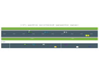<br><code>Highway_Discrete_</code><br><code>physics</code><br><sub>instances 0&ndash;4</sub></td><td align="center" valign="top">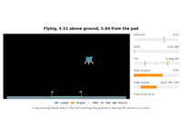<br><code>Lander_Continuous_</code><br><code>physics</code><br><sub>instances 0&ndash;2</sub></td><td align="center" valign="top">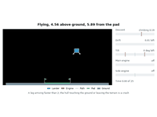<br><code>Lander_Discrete_</code><br><code>physics</code><br><sub>instances 0&ndash;2</sub></td><td align="center" valign="top">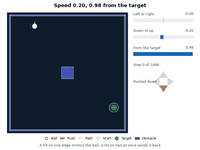<br><code>Pinball_physics</code><br><sub>instances 0&ndash;3</sub></td></tr>
<tr><td align="center" valign="top">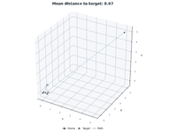<br><code>Quadcopter_physics</code><br><sub>instances 0, 1</sub></td><td align="center" valign="top">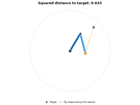<br><code>Reacher_physics</code><br><sub>instances 0, 1</sub></td><td align="center" valign="top">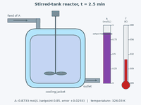<br><code>Reactor_physics</code><br><sub>instances 0</sub></td><td align="center" valign="top">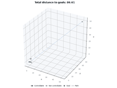<br><code>UAV_Continuous_physics</code><br><sub>instances 0, 1</sub></td></tr>
<tr><td align="center" valign="top">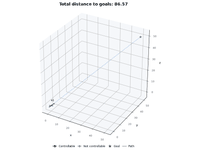<br><code>UAV_Discrete_physics</code><br><sub>instances 0</sub></td><td align="center" valign="top"><br><code>UAV_Mixed_physics</code><br><sub>instances 0</sub></td><td></td><td></td></tr>
</table>

<sub>[back to contexts](#domain-gallery)</sub>

### or

Operations research.

<table>
<tr><td align="center" valign="top">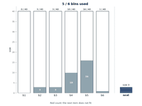<br><code>BinPacking_or</code><br><sub>instances 0</sub></td><td align="center" valign="top">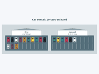<br><code>CarRental_or</code><br><sub>instances 0, 1</sub></td><td align="center" valign="top">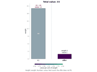<br><code>Knapsack_or</code><br><sub>instances 0</sub></td><td align="center" valign="top">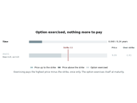<br><code>Option_or</code><br><sub>instances 0, 1</sub></td></tr>
<tr><td align="center" valign="top">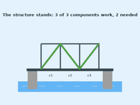<br><code>StructuralMaintenance_</code><br><code>or</code><br><sub>instances 0&ndash;4</sub></td><td align="center" valign="top">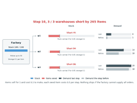<br><code>SupplyChain_or</code><br><sub>instances 0</sub></td><td align="center" valign="top">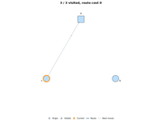<br><code>TSP_or</code><br><sub>instances 0</sub></td><td></td></tr>
</table>

<sub>[back to contexts](#domain-gallery)</sub>

### arcade

Arcade, puzzle and card games.

<table>
<tr><td align="center" valign="top">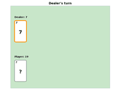<br><code>Blackjack_arcade</code><br><sub>instances 0</sub></td><td align="center" valign="top">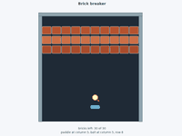<br><code>BrickBreaker_arcade</code><br><sub>instances 0</sub></td><td align="center" valign="top">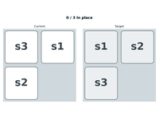<br><code>Eight_arcade</code><br><sub>instances 0, 1</sub></td><td align="center" valign="top">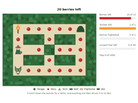<br><code>MazeChase_arcade</code><br><sub>instances 0&ndash;3</sub></td></tr>
<tr><td align="center" valign="top">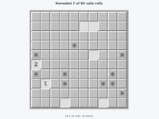<br><code>Minesweeper_arcade</code><br><sub>instances 0&ndash;2</sub></td><td align="center" valign="top">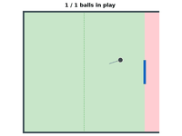<br><code>Pong_arcade</code><br><sub>instances 0, 1</sub></td><td align="center" valign="top">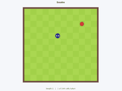<br><code>Snake_arcade</code><br><sub>instances 0</sub></td><td align="center" valign="top">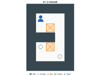<br><code>Sokoban_arcade</code><br><sub>instances 0, 1</sub></td></tr>
<tr><td align="center" valign="top">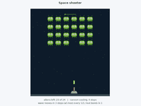<br><code>SpaceShooter_arcade</code><br><sub>instances 0</sub></td><td align="center" valign="top">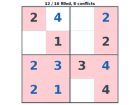<br><code>Sudoku_arcade</code><br><sub>instances 0, 1</sub></td><td align="center" valign="top">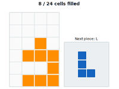<br><code>Tetris_arcade</code><br><sub>instances 0, 1</sub></td><td align="center" valign="top">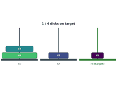<br><code>TowerOfHanoi_arcade</code><br><sub>instances 0</sub></td></tr>
<tr><td align="center" valign="top">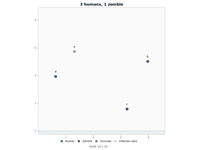<br><code>Zombies_arcade</code><br><sub>instances 0&ndash;3</sub></td><td></td><td></td><td></td></tr>
</table>

<sub>[back to contexts](#domain-gallery)</sub>

### gym

RDDL versions of the classic control environments of Gymnasium.

<table>
<tr><td align="center" valign="top">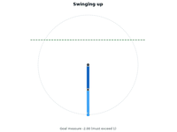<br><code>Acrobot_gym</code><br><sub>instances 0</sub></td><td align="center" valign="top">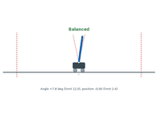<br><code>CartPole_Continuous_</code><br><code>gym</code><br><sub>instances 0</sub></td><td align="center" valign="top">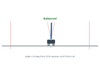<br><code>CartPole_Discrete_gym</code><br><sub>instances 0</sub></td><td align="center" valign="top"><br><code>MountainCar_</code><br><code>Continuous_gym</code><br><sub>instances 0</sub></td></tr>
<tr><td align="center" valign="top"><br><code>MountainCar_Discrete_</code><br><code>gym</code><br><sub>instances 0</sub></td><td align="center" valign="top"><br><code>Pendulum_gym</code><br><sub>instances 0</sub></td><td></td><td></td></tr>
</table>

<sub>[back to contexts](#domain-gallery)</sub>

### rddlsim

Examples from rddlsim, the original Java simulator of RDDL.

<table>
<tr><td align="center" valign="top"><br><code>ComplexSysAdmin_</code><br><code>rddlsim</code><br><sub>instances 0</sub></td><td align="center" valign="top"><br><code>Logistics_rddlsim</code><br><sub>instances 0</sub></td><td align="center" valign="top"><br><code>Pizza_rddlsim</code><br><sub>instances 0</sub></td><td align="center" valign="top"><br><code>PropDBN_rddlsim</code><br><sub>instances 0</sub></td></tr>
<tr><td align="center" valign="top"><br><code>Sidewalk_rddlsim</code><br><sub>instances 0, 1</sub></td><td align="center" valign="top"><br><code>Workforce_rddlsim</code><br><sub>instances 0</sub></td><td></td><td></td></tr>
</table>

<sub>[back to contexts](#domain-gallery)</sub>

### ippc2011

The International Probabilistic Planning Competition of 2011 ([site](http://users.cecs.anu.edu.au/~ssanner/IPPC_2011/)).

<table>
<tr><td align="center" valign="top"><br><code>CooperativeRecon_MDP_</code><br><code>ippc2011</code><br><sub>instances 1&ndash;10</sub></td><td align="center" valign="top"><br><code>CooperativeRecon_</code><br><code>POMDP_ippc2011</code><br><sub>instances 1&ndash;10</sub></td><td align="center" valign="top"><br><code>CrossingTraffic_MDP_</code><br><code>ippc2011</code><br><sub>instances 1&ndash;10</sub></td><td align="center" valign="top"><br><code>CrossingTraffic_POMDP_</code><br><code>ippc2011</code><br><sub>instances 1&ndash;10</sub></td></tr>
<tr><td align="center" valign="top"><br><code>Elevators_MDP_ippc2011</code><br><sub>instances 1&ndash;10</sub></td><td align="center" valign="top"><br><code>Elevators_POMDP_</code><br><code>ippc2011</code><br><sub>instances 1&ndash;10</sub></td><td align="center" valign="top"><br><code>GameOfLife_MDP_</code><br><code>ippc2011</code><br><sub>instances 1&ndash;10</sub></td><td align="center" valign="top"><br><code>GameOfLife_POMDP_</code><br><code>ippc2011</code><br><sub>instances 1&ndash;10</sub></td></tr>
<tr><td align="center" valign="top"><br><code>Navigation_MDP_</code><br><code>ippc2011</code><br><sub>instances 1&ndash;10</sub></td><td align="center" valign="top"><br><code>Navigation_POMDP_</code><br><code>ippc2011</code><br><sub>instances 1&ndash;10</sub></td><td align="center" valign="top"><br><code>SkillTeaching_MDP_</code><br><code>ippc2011</code><br><sub>instances 1&ndash;10</sub></td><td align="center" valign="top"><br><code>SkillTeaching_POMDP_</code><br><code>ippc2011</code><br><sub>instances 1&ndash;10</sub></td></tr>
<tr><td align="center" valign="top"><br><code>SysAdmin_MDP_ippc2011</code><br><sub>instances 1&ndash;10</sub></td><td align="center" valign="top"><br><code>SysAdmin_POMDP_</code><br><code>ippc2011</code><br><sub>instances 1&ndash;10</sub></td><td align="center" valign="top"><br><code>Traffic_CTM_MDP_</code><br><code>ippc2011</code><br><sub>instances 1&ndash;10</sub></td><td align="center" valign="top"><br><code>Traffic_CTM_POMDP_</code><br><code>ippc2011</code><br><sub>instances 1&ndash;10</sub></td></tr>
</table>

<sub>[back to contexts](#domain-gallery)</sub>

### ippc2014

The International Probabilistic Planning Competition of 2014 ([site](https://ssanner.github.io/IPPC_2014/)).

<table>
<tr><td align="center" valign="top"><br><code>AcademicAdvising_MDP_</code><br><code>ippc2014</code><br><sub>instances 1&ndash;10</sub></td><td align="center" valign="top"><br><code>AcademicAdvising_</code><br><code>POMDP_ippc2014</code><br><sub>instances 1&ndash;10</sub></td><td align="center" valign="top"><br><code>CrossingTraffic_MDP_</code><br><code>ippc2014</code><br><sub>instances 1&ndash;10</sub></td><td align="center" valign="top"><br><code>CrossingTraffic_POMDP_</code><br><code>ippc2014</code><br><sub>instances 1&ndash;10</sub></td></tr>
<tr><td align="center" valign="top"><br><code>Elevators_MDP_ippc2014</code><br><sub>instances 1&ndash;10</sub></td><td align="center" valign="top"><br><code>Elevators_POMDP_</code><br><code>ippc2014</code><br><sub>instances 1&ndash;10</sub></td><td align="center" valign="top"><br><code>SkillTeaching_MDP_</code><br><code>ippc2014</code><br><sub>instances 1&ndash;10</sub></td><td align="center" valign="top"><br><code>SkillTeaching_POMDP_</code><br><code>ippc2014</code><br><sub>instances 1&ndash;10</sub></td></tr>
<tr><td align="center" valign="top"><br><code>Tamarisk_MDP_ippc2014</code><br><sub>instances 1&ndash;10</sub></td><td align="center" valign="top"><br><code>Tamarisk_POMDP_</code><br><code>ippc2014</code><br><sub>instances 1&ndash;10</sub></td><td align="center" valign="top"><br><code>Traffic_MDP_ippc2014</code><br><sub>instances 1&ndash;10</sub></td><td align="center" valign="top"><br><code>Traffic_POMDP_ippc2014</code><br><sub>instances 1&ndash;10</sub></td></tr>
<tr><td align="center" valign="top"><br><code>TriangleTireworld_MDP_</code><br><code>ippc2014</code><br><sub>instances 1&ndash;10</sub></td><td align="center" valign="top"><br><code>TriangleTireworld_</code><br><code>POMDP_ippc2014</code><br><sub>instances 1&ndash;10</sub></td><td align="center" valign="top"><br><code>Wildfire_MDP_ippc2014</code><br><sub>instances 1&ndash;10</sub></td><td align="center" valign="top"><br><code>Wildfire_POMDP_</code><br><code>ippc2014</code><br><sub>instances 1&ndash;10</sub></td></tr>
</table>

<sub>[back to contexts](#domain-gallery)</sub>

### ippc2018

The International Probabilistic Planning Competition of 2018 ([site](https://ipc2018-probabilistic.bitbucket.io/)).

<table>
<tr><td align="center" valign="top"><br><code>AcademicAdvising_</code><br><code>ippc2018</code><br><sub>instances 1&ndash;20</sub></td><td align="center" valign="top"><br><code>ChromaticDice_ippc2018</code><br><sub>instances 1&ndash;20</sub></td><td align="center" valign="top"><br><code>CooperativeRecon_</code><br><code>ippc2018</code><br><sub>instances 1&ndash;20</sub></td><td align="center" valign="top"><br><code>EarthObservation_</code><br><code>ippc2018</code><br><sub>instances 1&ndash;20</sub></td></tr>
<tr><td align="center" valign="top"><br><code>Manufacturer_ippc2018</code><br><sub>instances 1&ndash;20</sub></td><td align="center" valign="top"><br><code>PushYourLuck_ippc2018</code><br><sub>instances 1&ndash;20</sub></td><td align="center" valign="top"><br><code>RedFinnedBlueEye_</code><br><code>ippc2018</code><br><sub>instances 1&ndash;20</sub></td><td align="center" valign="top"><br><code>WildlifePreserve_V1_</code><br><code>ippc2018</code><br>to<br><code>WildlifePreserve_V20_</code><br><code>ippc2018</code><br><sub>instances the variant number</sub></td></tr>
</table>

<sub>[back to contexts](#domain-gallery)</sub>

### ippc2023

The International Probabilistic Planning Competition of 2023 ([site](https://ipc2023.github.io)).

<table>
<tr><td align="center" valign="top"><br><code>HVAC_ippc2023</code><br><sub>instances 0&ndash;7</sub></td><td align="center" valign="top"><br><code>MarsRover_ippc2023</code><br><sub>instances 0&ndash;5</sub></td><td align="center" valign="top"><br><code>MountainCar_ippc2023</code><br><sub>instances 1&ndash;5</sub></td><td align="center" valign="top"><br><code>PowerGen_ippc2023</code><br><sub>instances 1&ndash;5</sub></td></tr>
<tr><td align="center" valign="top"><br><code>RaceCar_ippc2023</code><br><sub>instances 0&ndash;6</sub></td><td align="center" valign="top"><br><code>RecSim_ippc2023</code><br><sub>instances 0&ndash;7</sub></td><td align="center" valign="top"><br><code>Reservoir_ippc2023</code><br><sub>instances 1&ndash;5</sub></td><td align="center" valign="top"><br><code>UAV_ippc2023</code><br><sub>instances 1&ndash;5</sub></td></tr>
</table>

<sub>[back to contexts](#domain-gallery)</sub>

<!-- DOMAINS:END -->

To refresh the gallery after adding domains, run ``python generate_domain_list.py --thumbnails``.

## License

This software is distributed under the MIT License.
